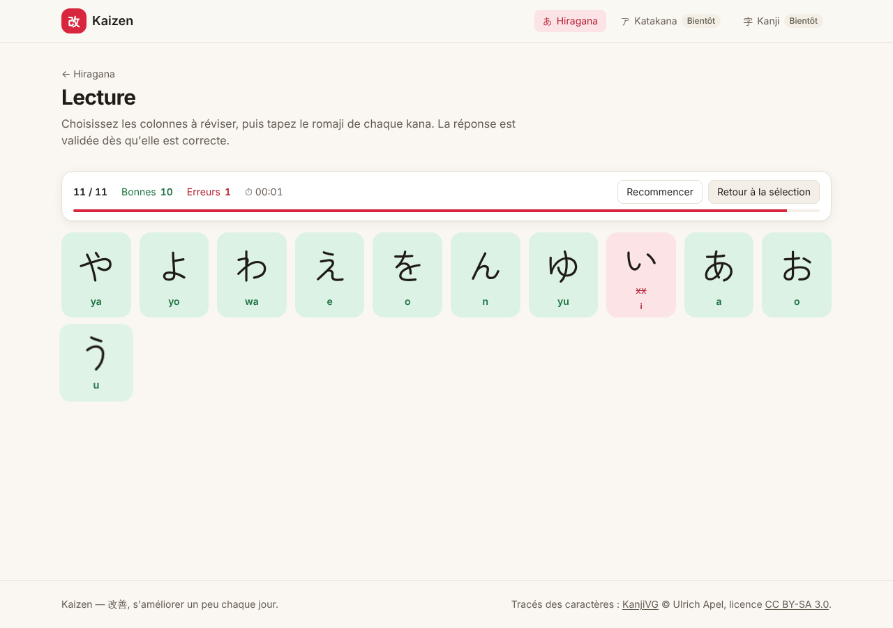
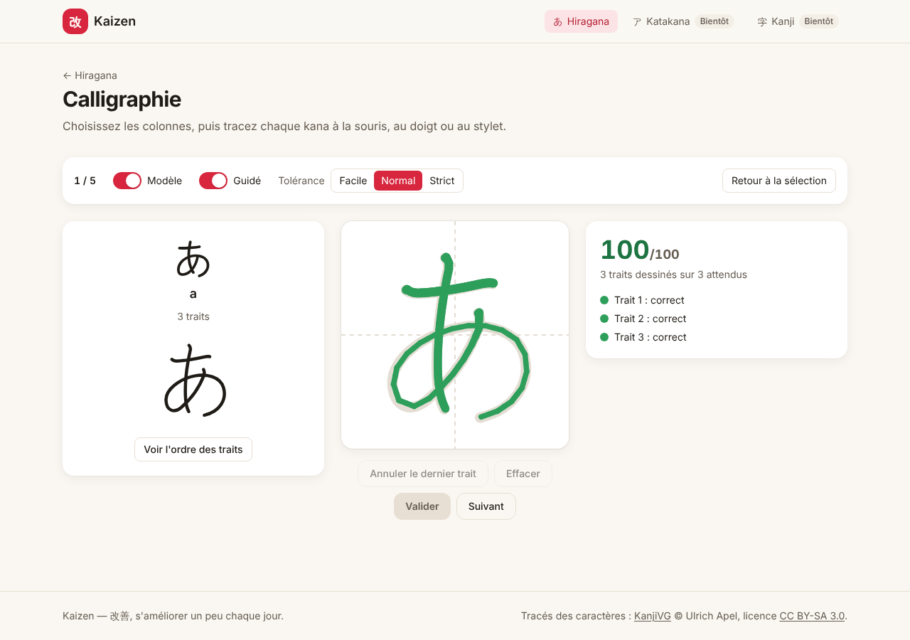
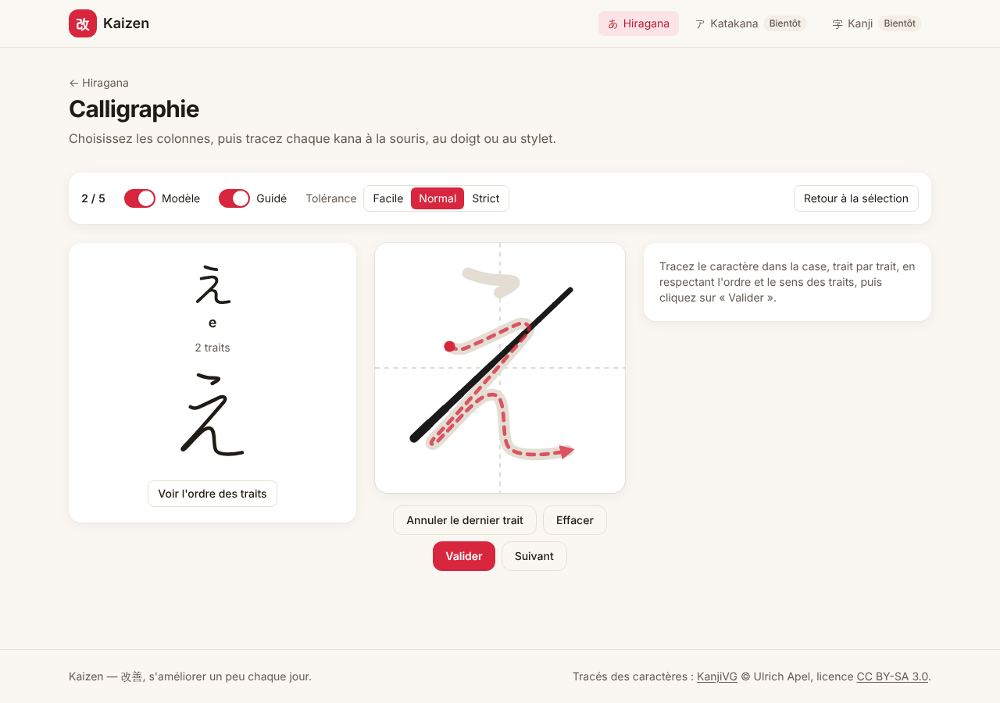
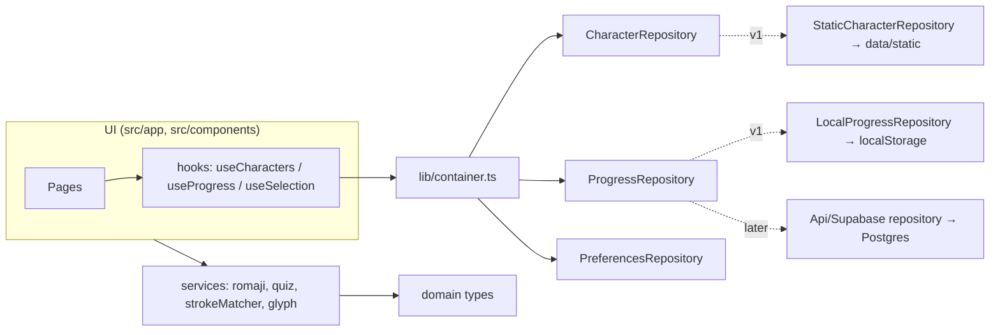

# Kaizen 改善

> Learn to read and write Japanese: a Tofugu-style kana reading quiz and an interactive calligraphy notebook that checks your stroke order.

[](https://github.com/TheGreatArthur/KAIZEN/actions/workflows/ci.yml)
[](LICENSE)



| Calligraphy with feedback | Guided mode |
|---|---|
|  |  |

Live demo: _coming soon_ · Portfolio page: _coming soon_

The UI is in French. Romaji follow the Hepburn system.

## Features

- **Reading quiz**: a faithful take on [kana-quiz.tofugu.com](https://kana-quiz.tofugu.com). You pick columns, then get a shuffled grid of cards. An answer is validated as soon as it is correct, and the focus moves on by itself. Results list the mistakes so you can retry them.
- **Calligraphy**: the KanjiVG stroke-order animation, a brush-like canvas (mouse, touch or stylus), a model overlay, a guided mode (next stroke dashed with an arrow) and three tolerance levels (easy / normal / strict).
- **Rule-based stroke matcher** (no AI): checks stroke count, direction, position and shape. Each stroke gets green, orange or red feedback, plus a score out of 100.
- **Complete hiragana data**: 46 main kana, 25 dakuten/handakuten and 33 combinations (yōon), with alternative romaji (`shi/si`, `n/nn`, ...).
- **Database-ready architecture**: async repositories behind a single container, stable ids, and an anonymous user id for a later migration to accounts. See [docs/DATABASE.md](docs/DATABASE.md).
- Responsive, keyboard accessible, dark mode (the writing box stays white).

## Architecture



```
src/
  domain/          Business types, framework-free (Character, AttemptResult, CharacterStats, ExerciseSession)
  data/static/     Hard-coded content (hiragana.ts + builder shared by all kana scripts)
  repositories/    Interfaces + implementations (static, localStorage)
  services/        Business logic: romaji validation, quiz helpers, SVG path parsing, glyph loading, strokeMatcher
  lib/             container.ts (picks implementations), storage, navigation, formatting
  hooks/           The only way UI reads or writes data
  components/      KanaSelector, QuizGrid, QuizCard, ResultsPanel, StrokeAnimator, DrawingCanvas, ...
  app/             Routes
public/kanjivg/    KanjiVG SVG files for hiragana (CC BY-SA 3.0)
docs/              ADRs, DATABASE.md, screenshots
```

Routes: `/`, `/hiragana`, `/hiragana/lecture`, `/hiragana/calligraphie`. The routes `/hiragana/cours`, `/katakana/*` and `/kanji/*` show a "Bientôt" placeholder for now.

## Tech stack

Next.js 16 (App Router), React 19, TypeScript (strict), Tailwind CSS 4, Vitest 3, pnpm. Fonts: Inter and Zen Maru Gothic.

## Quick start

Prerequisites: Node.js ≥ 20 and pnpm ≥ 9 (`corepack enable`). No environment variables are needed.

```bash
make dev        # = pnpm install && pnpm dev → http://localhost:3000
```

Other commands: `make test`, `make lint` (ESLint + `tsc`), `make build`, `make ci` (all of them).

## Tests

```bash
pnpm test             # unit tests
pnpm test:coverage    # with coverage report
```

The tests cover romaji validation (variants, the `ん` case), the hiragana data (counts, ids, KanjiVG files, `や`/`わ` gaps), the quiz helpers, the SVG path parser, the `strokeMatcher` (on real KanjiVG strokes: perfect, shaky, reversed, misordered, missing and extra strokes, tolerance levels) and `LocalProgressRepository`.

## Adding a new script (e.g. katakana)

The exercises are generic: they take a `script` prop. Adding katakana means adding data, not code.

1. Copy the KanjiVG files for the katakana into `public/kanjivg/` (file name = 5-digit hex code point, e.g. `030ab.svg` for カ).
2. Create `src/data/static/katakana.ts`: the same `ROWS` structure as `hiragana.ts` (cells, `null` for empty slots, romaji variants) and its `STROKES` map, then `buildCharacters("katakana", ROWS, STROKES)`. Ids are prefixed with `kata-`.
3. Register it in `src/data/static/index.ts` (`katakana: KATAKANA`).
4. Replace the placeholder pages in `src/app/katakana/` with the hiragana ones, changing `script="katakana"`: `<ReadingExercise script="katakana" />`, `<CalligraphyExercise script="katakana" />`, `<ExerciseCards script="katakana" />`.
5. Set `available: true` for katakana in `src/lib/navigation.ts`.

Kanji will need their own extension (meanings, on/kun readings, JLPT level). See the `kanji` table in [docs/DATABASE.md](docs/DATABASE.md).

## Decisions

Architecture Decision Records are in [docs/adr/](docs/adr/):
- [0001: stack](docs/adr/0001-stack.md)
- [0002: repository layer](docs/adr/0002-repository-layer.md)
- [0003: stroke matching](docs/adr/0003-stroke-matching.md)

## Roadmap / known limitations

- [ ] Hiragana lessons (`/hiragana/cours`), then katakana, then kanji
- [ ] Accounts and server-side progress (see the migration plan in [docs/DATABASE.md](docs/DATABASE.md))
- [ ] Spaced repetition based on `character_stats`
- Progress is stored per browser until accounts exist.
- The stroke matcher thresholds are empirical and will be tuned with real handwriting samples.

## License

Code: [MIT](LICENSE). Stroke data: [KanjiVG](https://kanjivg.tagaini.net) © Ulrich Apel, [CC BY-SA 3.0](https://creativecommons.org/licenses/by-sa/3.0/).
