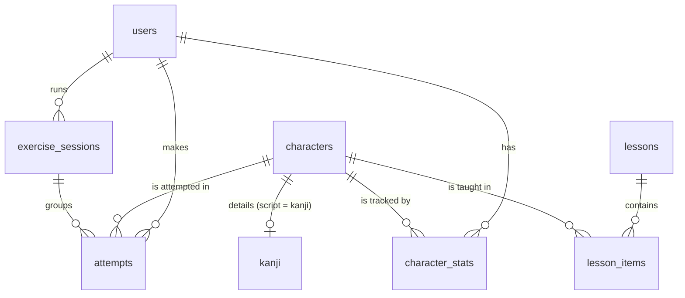

# Future database schema

v1 has no database: characters are static (`src/data/static`) and progress is stored in
`localStorage` (`LocalProgressRepository`). This document describes the target relational schema
(PostgreSQL / Supabase) and the migration strategy. The domain types in `src/domain` already
match these tables.

## Entity relationship diagram

## Tables

### `characters`
| column | type | notes |
|---|---|---|
| `id` | `text` PK | stable id, e.g. `hira-ka`, `kata-ka`, `kanji-6c34` |
| `script` | `text` not null | `hiragana` \| `katakana` \| `kanji` (check constraint or enum) |
| `char` | `text` not null | |
| `romaji` | `text[]` not null | accepted answers, the first one is canonical (kana only) |
| `row` | `text` | consonant row (`ka`), null for kanji |
| `group` | `text` | `main` \| `dakuten` \| `combination` |
| `slot` | `smallint` | vertical position in the row (keeps gaps) |
| `stroke_count` | `smallint` not null | |
| `svg_path` | `text[]` not null | KanjiVG files (or a storage URL) |
| `sort_order` | `integer` not null | |

Indexes: `unique (script, char)`, `(script, group, sort_order)`.

### `kanji` (1–1 extension of `characters` where `script = 'kanji'`)
| column | type | notes |
|---|---|---|
| `character_id` | `text` PK, FK → `characters.id` on delete cascade | |
| `meanings_fr` | `text[]` | |
| `meanings_en` | `text[]` | |
| `on_readings` | `text[]` | katakana |
| `kun_readings` | `text[]` | hiragana, with okurigana marked by `.` |
| `jlpt_level` | `smallint` | 5 → 1, check `between 1 and 5` |
| `grade` | `smallint` | Jōyō grade |
| `radical` | `text` | |
| `frequency` | `integer` | |

Indexes: `(jlpt_level)`, GIN on `on_readings` and `kun_readings` for reading search.

### `lessons`
| column | type | notes |
|---|---|---|
| `id` | `uuid` PK | |
| `slug` | `text` unique | used in URLs (`/hiragana/cours/ligne-ka`) |
| `script` | `text` not null | |
| `title` | `text` not null | |
| `content` | `jsonb` | rich content (MDX/blocks) |
| `position` | `integer` not null | |
| `published_at` | `timestamptz` | |

Index: `(script, position)`.

### `lesson_items`
| column | type | notes |
|---|---|---|
| `lesson_id` | `uuid` FK → `lessons.id` on delete cascade | |
| `character_id` | `text` FK → `characters.id` | |
| `position` | `integer` not null | |
| `mnemonic` | `text` | |

PK: `(lesson_id, character_id)`. Index: `(character_id)`.

### `users`
| column | type | notes |
|---|---|---|
| `id` | `uuid` PK | = `auth.users.id` with Supabase |
| `email` | `citext` unique | |
| `display_name` | `text` | |
| `legacy_local_id` | `uuid` unique | anonymous localStorage id, migrated (see below) |
| `created_at` | `timestamptz` default `now()` | |

### `exercise_sessions`
| column | type | notes |
|---|---|---|
| `id` | `uuid` PK | same id as the local session |
| `user_id` | `uuid` FK → `users.id` on delete cascade | |
| `script` | `text` not null | |
| `exercise` | `text` not null | `reading` \| `calligraphy` |
| `character_ids` | `text[]` | |
| `started_at` / `finished_at` | `timestamptz` | |
| `correct` / `total` | `integer` | |

Index: `(user_id, started_at desc)` (drives "Resume" and "last session").

### `attempts` (append-only)
| column | type | notes |
|---|---|---|
| `id` | `bigint` identity PK | |
| `user_id` | `uuid` FK → `users.id` on delete cascade | |
| `character_id` | `text` FK → `characters.id` | |
| `session_id` | `uuid` FK → `exercise_sessions.id` on delete set null | |
| `exercise` | `text` not null | |
| `correct` | `boolean` not null | |
| `answer` | `text` | reading: romaji typed |
| `score` | `smallint` | calligraphy: 0–100 |
| `created_at` | `timestamptz` not null | |

Indexes: `(user_id, character_id, created_at desc)` and `(session_id)`. Partition by month if the table grows large.

### `character_stats` (materialised aggregate, maintained by trigger or by the API)
| column | type | notes |
|---|---|---|
| `user_id` | `uuid` FK | |
| `character_id` | `text` FK | |
| `exercise` | `text` | `all` row + one row per exercise |
| `attempts` / `correct` / `streak` | `integer` | |
| `last_attempt_at` | `timestamptz` | |
| `next_review_at` | `timestamptz` | for a future spaced repetition |

PK: `(user_id, character_id, exercise)`. Index: `(user_id, next_review_at)`.

With Supabase, Row Level Security on `attempts`, `character_stats`, `exercise_sessions` and `users`: `user_id = auth.uid()`.

## Migration: localStorage → database

1. **Implement the remote repositories.** `ApiProgressRepository` (or `SupabaseProgressRepository`) implements the same `ProgressRepository` interface, and `ApiCharacterRepository` reads `characters`. Seed `characters` from `src/data/static`: the ids are already stable.
2. **Switch in `src/lib/container.ts`.** Choose the implementation from the session: use the remote repository when the user is logged in, otherwise keep the local one. The UI is unchanged.
3. **Import on first login.**
   - Read the local data: `kaizen:v1:userId`, then `kaizen:v1:<userId>:attempts`, `:sessions` and `:stats` (`LocalProgressRepository.getAttempts()` exposes the raw attempts).
   - `POST /api/progress/import` with `{ legacyLocalId, attempts, sessions }`. The server is idempotent: it refuses a `legacy_local_id` already linked to another account, and inserts sessions with `on conflict (id) do nothing`.
   - The server recomputes `character_stats` from the attempts, which are the source of truth. The local `stats` are only a cache.
   - Once the server confirms, mark `kaizen:v1:<userId>:migrated = <accountId>` and stop writing locally.
4. **Raw-attempt limit.** Only the latest 2,000 attempts are kept locally. For older history, the local aggregated `stats` are imported as a base row (`attempts`, `correct`, `streak`).
5. **Preferences** (column selection) move to a `user_preferences (user_id, key, value jsonb)` table, or stay local since they are not critical.
